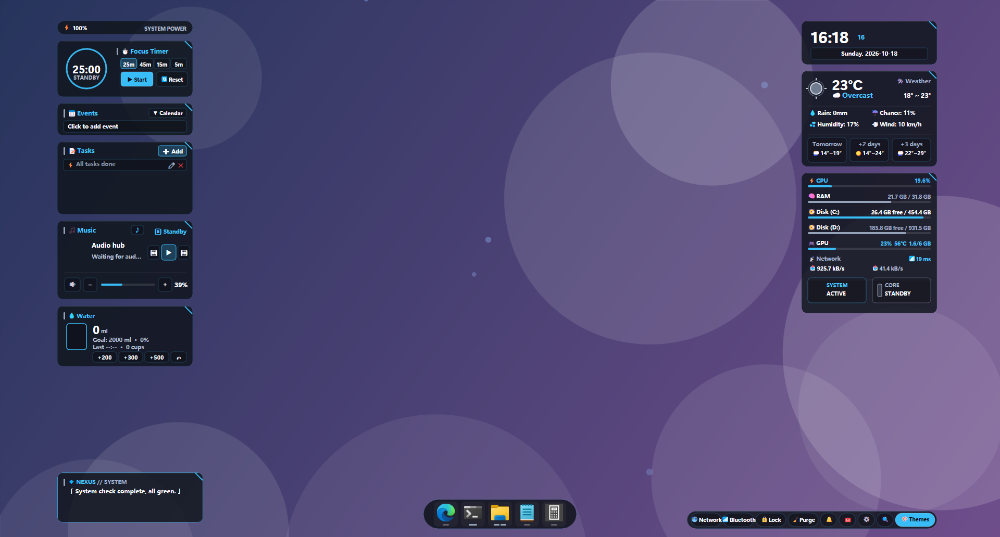
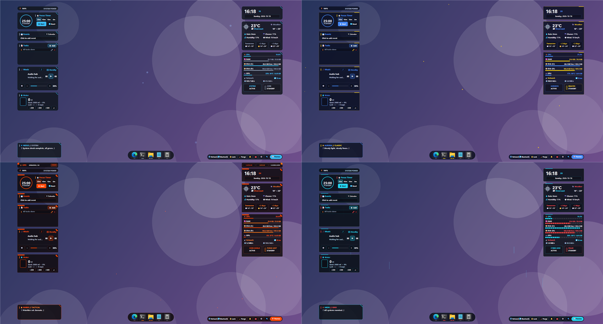

<p align="center"></p>

<p align="center"><b>English</b> | <a href="README.zh-CN.md">简体中文</a></p>

# Perch

A lightweight, pure-Rust (Direct2D) desktop HUD for Windows 10/11 — floating cards on your desktop, an app dock with
window previews, a quick launcher and a small toolbox. Built for **low CPU and RAM**: about 40 MB private working set,
and almost no CPU while the desktop is covered by windows.



## Features

- **Cards** — pomodoro timer, calendar (ICS subscriptions), todo (optional two-way Obsidian daily-note sync),
  media (Windows media session), water reminder, weather, system monitor, battery, quotes.
- **Dock** — running-app detection (event driven, no polling), hover window previews, per-entry single/multi launch.
- **Launcher** — apps / files (via [Everything](https://www.voidtools.com/) if installed) / windows / ask-AI / system commands, frecency ranking.
- **Toolbox** — clipboard history, inbox, quick settings (brightness, audio output device, Clash controller).
- **Themes** — data-driven theme packs with hot reload, audio spectrum and ambient particles (paused while covered).
- **UI languages** — English and Simplified Chinese (`[ui] language`, default follows the system).
- **Everything is optional** — no wallpapers, Obsidian, Clash or special hardware are needed.



## Install

### Download (recommended)

Grab `perch-windows-x64.zip` from the [Releases](../../releases) page, extract it anywhere and run `perch.exe`.
Everything the HUD needs is created next to the executable on first run (`config.toml`, `@Resources\...`).

The executable is not code-signed, so Windows SmartScreen may warn on first launch: choose **More info → Run anyway**.

### Build from source

Requires Rust (stable, MSVC toolchain) on Windows 10/11.

```powershell
cd perch-core; cargo build --release
cd ..\perch; cargo build --release
```

Or run `tools\deploy-hud.ps1`: it builds both crates and installs them to `%LOCALAPPDATA%\perch`
(`-InstallDir <dir>` chooses another folder, `-ThemePacks <dir>` copies extra theme packs, `-NoStart` skips launching).

```
<install dir>\perch.exe
<install dir>\config.toml                 created on first run
<install dir>\@Resources\bin\perch-core.exe
<install dir>\@Resources\{data,weather,battery,...}   created at runtime
<install dir>\themes\*.toml               optional extra theme packs
```

User state lives in `%APPDATA%\perch`. Autostart is up to you (a scheduled task or a Startup shortcut).
The runtime root is resolved from the executable location, then the `PERCH_HOME` environment variable.

## First run

Start `perch.exe`. It creates `config.toml` with sensible defaults, fetches weather and battery once, generates the
default theme and shows the cards on your primary monitor. Right-click the tray icon for settings, theme selector,
monitor selection and "Reload Configuration". The HUD hides while a window covers the whole monitor and returns when you
show the desktop (`Win+D`).

Default hotkeys: `Win+Alt+H` show/hide, `Win+Alt+L` float/widget, `Win+Alt+S` launcher, `Win+Alt+V` toolbox.

## Configuration

`config.toml` is reloaded from the tray menu. Sections include `[ui]`, `[hotkeys]`, `[alert]`, `[widgets]`,
`[calendar]`, `[notes]` (Obsidian), `[audio]`, `[pomodoro]`, `[system]`, `[display]`, `[[dock]]`, `[music_assistant]`,
`[thresholds]`, `[intervals]`, `[dock_settings]`. Every option is commented in the generated file.

### Battery card

By default the battery card shows your laptop battery; on a desktop PC without a battery the card hides itself.
To show a wireless mouse / keyboard instead (or as well), add one or more `[[battery]]` sources — the first one that
returns a value is shown:

```toml
[[battery]]
kind = "hid"            # read the battery level a wireless device reports over HID
name = "My Mouse"
vendor_id = 0x1234
product_id = 0x5678
usage_page = 0xFF00     # defaults shown
usage = 2
battery_byte = 6        # which byte of the input report holds the percentage

[[battery]]
kind = "system"         # fall back to the laptop battery
```

Finding the numbers: run `perch-core.exe battery list` — it writes and opens `@Resources\data\hid_devices.txt` with every
HID device (vendor-defined ones first). Then `perch-core.exe battery dump 0x1234 0x5678` captures a few input reports into
`@Resources\data\hid_dump.txt`; the byte that tracks the battery level is your `battery_byte`. Vendor protocols differ,
so not every device exposes its level this way — if yours does not work, open an issue and attach the dump.

## Theme packs

A theme is one TOML file. Eight packs are built in (`default`, `aurora`, `orchid`, `crimson`, `neon`,
`lavender`, `rose`, `ember`). To add or override one, put `<id>.toml` into `<install dir>\themes\`;
it appears in the theme selector without rebuilding. Missing fields fall back to the `default` theme.

```toml
v = 2
id = "mytheme"
order = 100                # position in the selector
replaces = ""              # optional: id of a built-in theme this pack replaces in the selector

[meta]    name = "My Theme"; description = "..."; title = "..."; preview = [66, 133, 244]
[colors]  accent / sub / bg / dock_bg / stroke / item_bg / item_hover / pill_bg / white / muted / on_accent / on_sub / danger / warn / ok
[style]   font_main / font_num / radius / frame_stroke / frame_width / shape2 / corner / bar_h / seg_color
          chrome = "none" | "tactical"     # tactical adds a top status bar (chrome_title / chrome_sub / chrome_badges)
[labels]    dock_title / field_name / unit_name / title_* / sub_* / lbl_*
[labels_en] the same keys; used instead of [labels] when the UI language is English (only fill what differs)
[fx]        kind = "dot" | "petal" | "diamond" | "heart" | "streak"; rgb; size_*; speed_*; up; sway; alpha_*
[wallpaper] prefix = "mytheme"
[messages]  water = "..."
[quotes]    speaker = "..."; lines = ["Original line#CRLF#Optional translation"]
```

See `perch-data/builtin/*.toml` for complete examples. After changing the UI language, re-select a theme once so its
labels are regenerated.

## Wallpapers

Not included. For per-theme wallpapers put `<prefix>.png` (or `<prefix>_day_N.png` / `<prefix>_night_N.png`)
into `@Resources\wallpapers`. Without such files the HUD leaves your wallpaper untouched.

## Troubleshooting

- **Nothing shows up** — another window may cover the monitor; press `Win+D`. Check `[display] monitor` in `config.toml`.
- **Second instance does nothing** — only one HUD runs at a time; exit the tray icon first.
- **File search says "Everything not found"** — install and start Everything (the launcher's file mode needs it).
- **Logs** — `%APPDATA%\perch\hud.log` (also reachable from Settings → About).

## Repository layout

- `perch/`  the HUD (thin client: rendering and input)
- `perch-core/` command-line tool and background jobs (weather, battery, themes, water reminder, wallpaper sync, media)
- `perch-data/` shared data models, paths, theme packs, UI strings, atomic TOML/JSON I/O
- `tools/`      deploy / smoke / soak scripts

CI builds every push and attaches a Windows zip to each `v*` tag (see `.github/workflows`).

## License

MIT, see [LICENSE](LICENSE).
